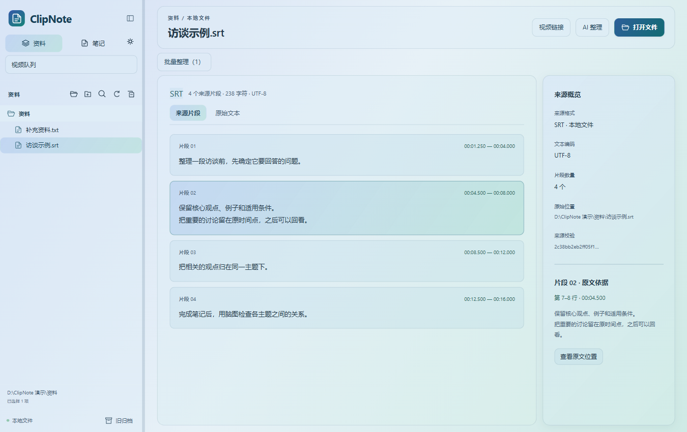
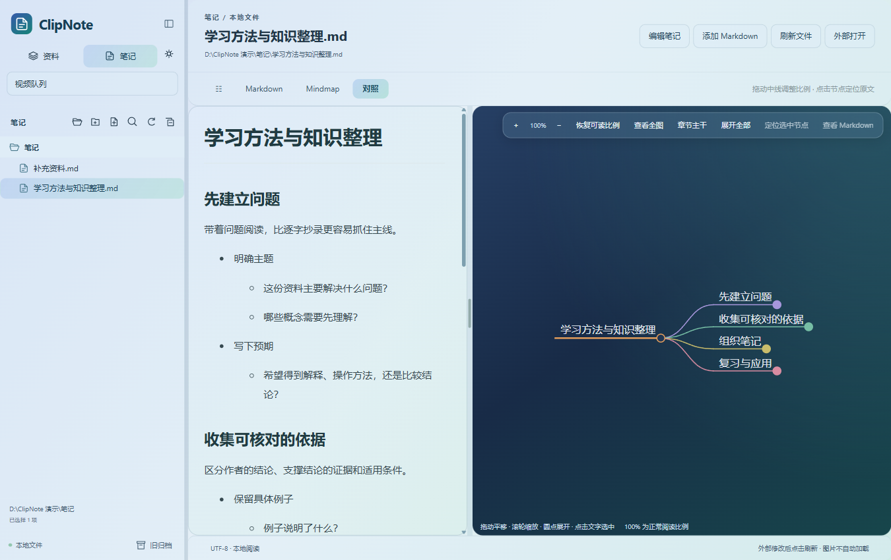

# ClipNote

ClipNote 是一款 Windows 桌面应用。把视频字幕或文本整理成 Markdown 笔记，再用正文和脑图对照阅读。原文可以逐段核对，生成的笔记保存在你选择的本地文件夹里，也可以用 Obsidian 或其他 Markdown 编辑器打开。

## 快速开始

Windows x64 用户可查看 [GitHub Releases](https://github.com/yuenanmu/ClipNote/releases) 和 [便携版使用说明](docs/Windows便携版使用说明.md)。完整解压后双击 `ClipNote.exe`。

1. 打开 [示例字幕](project/tests/fixtures/示例%20字幕.srt)，下载到本机，再在 ClipNote 中打开。点击字幕片段可核对时间和原文。
2. 如需 AI 整理，在设置中填写兼容 API 的地址、模型和密钥，或使用应用内的 ChatGPT 订阅登录入口。选中文件后点击「AI 整理」，可以切换服务和提示词模板，再确认发送内容和笔记保存位置。
3. 整理完成后，在「笔记」里打开 Markdown。可切换正文、脑图和双栏对照，也可点击左上角的小图标收起侧栏。

导入 SRT、VTT、TXT 和 Markdown、查看字幕与阅读已有笔记都可在本地完成。使用 AI 整理时，确认发送的资料会交给所选服务。如需从视频提取字幕，可连接独立安装的 SmartSub，在「视频队列」添加多个链接。完成后可打开字幕，并把原文件一键复制到资料文件夹。

## 功能预览

### 逐段核对字幕原文



### 看清 AI 整理进行到哪一步


### 用正文和脑图对照阅读



## 从源码运行

在仓库根目录执行以下命令。首次环境准备、依赖和完整验证步骤见 [开发指南](project/README.md)。

```powershell
npm.cmd --prefix .\project ci
npm.cmd --prefix .\project run build
npm.cmd --prefix .\project start
```

版本改动见 [v0.3.0 发布说明](docs/ClipNote%20v0.3.0%20发布说明.md)。开发进度和验证记录见 [任务清单](docs/任务清单.md)。