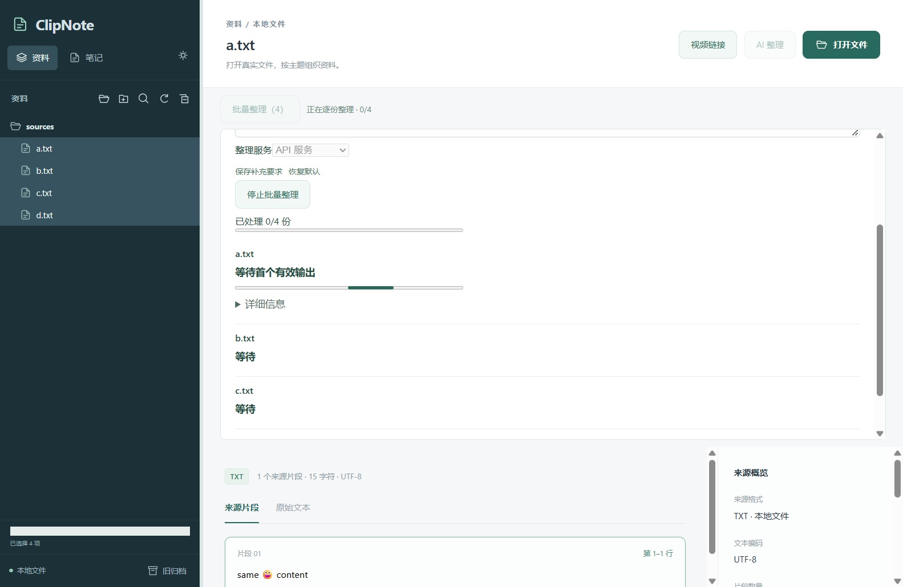

# ClipNote

ClipNote 是一款 Windows 桌面应用。把视频字幕或已有文本整理成带来源引用的 Markdown 笔记，再用正文和脑图一起阅读。笔记保存在你选择的本地文件夹里，也可以用 Obsidian 或其他 Markdown 编辑器打开。

## 快速开始

1. 打开 [示例字幕](project/tests/fixtures/示例%20字幕.srt)，下载到本机，再在 ClipNote 中打开。点击字幕片段可核对时间和原文。
2. 如需 AI 整理，在设置中填写兼容 API 的地址、模型和密钥，或使用应用内的 ChatGPT 订阅登录入口。选中文件后点击「AI 整理」，确认发送内容和笔记保存位置。
3. 整理完成后，在「笔记」里打开 Markdown。可切换正文、脑图和双栏对照。

导入 SRT、VTT、TXT 和 Markdown、查看字幕与阅读已有笔记都可在本地完成。使用 AI 整理时，确认发送的资料会交给所选服务。SmartSub 是可选的独立工具，用于从支持的视频来源获取字幕或转写。

## 功能预览

### 逐段核对字幕原文


### 看清 AI 整理进行到哪一步



### 用正文和脑图对照阅读


## 从源码运行

在仓库根目录执行以下命令。首次环境准备、依赖和完整验证步骤见 [开发指南](project/README.md)。

```powershell
npm.cmd --prefix .\project ci
npm.cmd --prefix .\project run build
npm.cmd --prefix .\project start
```

Windows 便携版的下载与使用说明将在通过预览版验收后随 Release 提供。当前已实现和待验收内容见 [任务清单](docs/任务清单.md)。