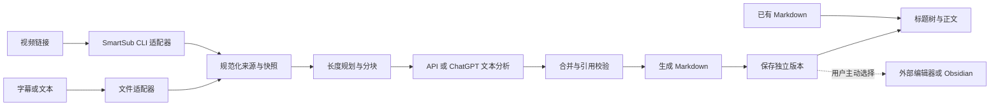

# ClipNote 架构

> 首版设计，尚无业务实现。范围见[项目索引](项目索引.md)，任务授权与验证见[任务清单](任务清单.md)。以下源码位置均为计划路径，当前不创建。

## 1. 实际使用方式

用户打开 App，可粘贴视频链接、导入 SRT/VTT/TXT/MD，或直接打开已有 Markdown。分析前选 API 或 ChatGPT 登录和保存目录。App 显示获取、分析、整理、保存阶段；完成后用左侧标题树定位右侧正文，并查看原文依据。

直接阅读不联网、不启动 SmartSub；文件分析仅需要 AI 连接。链接任务按需调用 SmartSub，优先已有字幕，无字幕才准备转写。缺程序或模型时明确引导准备，拒绝下载则保留任务并说明缺少条件。

首版只读（流程、范围和保存方式已获用户确认）。用户可主动选择外部编辑器，保存后在 ClipNote 刷新或重开。只有主动点击才尝试 Obsidian；文件不在已知笔记库时展示文件夹或交给系统选择编辑器，不默默创建库。

## 2. 数据流与模块

模块设计的统一入口为[模块索引](模块/模块索引.md)。它说明契约归属、调用方向和关联任务；实际完成标记统一读取任务清单复选框。

| 模块 | 职责 | 输入 → 输出 | 计划位置 | 模块文档 |
|---|---|---|---|---|
| 桌面壳与桥接 | 窗口、文件选择、受限本地能力、凭据保护 | 界面操作 → 受约束命令/事件 | `project/src/main/`、`project/src/preload/` | [详设](模块/桌面壳与公共契约.md) |
| 文件来源 | 解析四种格式，保留原始快照 | 路径 → SourceDocument | `project/src/modules/source/` | [详设](模块/文件来源.md) |
| SmartSub 来源 | 发现安装、准备资源、CLI、任务查询、读取字幕 | 链接/转写任务 → SourceDocument | `project/src/modules/smartsub/` | [详设](模块/SmartSub适配.md) |
| 文本分析 | 分块、服务适配、结构输出、合并及引用校验 | 来源 + Profile → NoteOutline | `project/src/modules/analysis/` | [详设](模块/AI分析.md) |
| 本地保存 | 来源、Markdown、元数据、版本和保存恢复 | 来源快照 + Markdown + 元数据 → SavedRevision | `project/src/modules/storage/` | [详设](模块/本地存储与版本.md) |
| 阅读器 | Markdown AST、标题树、正文、来源定位 | MD/保存版本 → 阅读视图 | `project/src/renderer/features/reader/` | [详设](模块/Markdown阅读.md) |
| 任务协调 | 状态、取消、重试、检查点 | 用户请求 → Job 状态/结果 | `project/src/modules/jobs/` | [详设](模块/任务协调与恢复.md) |
| 公共契约 | 模块数据及 IPC 类型 | 明确的数据对象 | `project/src/contracts/` | [详设](模块/桌面壳与公共契约.md) |

主进程负责文件、网络、登录回调、任务与 SmartSub；耗时解析/整理放工作线程或独立工作进程。React 层经受限 preload 调用，不直接获取密钥或执行命令。窗口启用 contextIsolation 和 sandbox，关闭 nodeIntegration；这些设置须在后续打包运行中核验。

受限操作包括导入、开始/取消/重试、阶段查询、版本列表、打开/刷新、服务配置、登录/退出、SmartSub 检查/准备。具体方法签名在源码任务锁定；不向页面暴露任意 shell 或任意文件系统能力。

## 3. 最小内部契约

| 对象 | 必需信息 | 约束 |
|---|---|---|
| SourceDocument | sourceId、类型、原路径/URL、格式、原始快照、有序 segments、可用语言/时长 | 来源仅为资料，不执行其中指令 |
| SourceSegment | 稳定 segmentId、原文、顺序、可选起止毫秒、原文行/字符范围 | 时间来自实际字幕/转写；TXT/MD 用段落/行，不虚构时间 |
| ChunkPlan | 块 ID、片段 ID/范围、重叠区间、请求预算依据 | 拆分和合并保留来源标识，超长单段按范围追溯 |
| Profile | 接入方式、服务地址、模型 ID、凭据引用、配置版本 | API/订阅独立；凭据不进入任务/输出 |
| NoteOutline | 标题、摘要、递归章节、内容条目与 sourceRefs | 通过结构及引用校验，不能引用不存在的片段 |
| GenerationAttempt | attemptId、来源、服务/模型快照、提示词版本、块/合并结果 | 切换服务新建尝试，可复用来源，保留归属 |
| SavedRevision | revisionId、notePath、sourcePath、manifestPath、校验值 | 独立版本，不被重生成覆盖；相对引用可迁移 |
| Job | jobId、阶段、检查点、SmartSub 任务 ID、尝试 ID、结果/错误 | 一个活动任务，不凭标题判断同一任务 |

这些是设计契约，不是已经发布的 API。未来可扩展字段，但来源 ID、引用含义与版本归属保持一致。

## 4. 分析与质量

1. 请求 AI 前保存原始快照和规范化片段；清理格式不改写原意。
2. 短内容在预算内整体分析，超长内容按语义分块并记录重叠；预算根据所选模型配置，不截断原文后假称完整整理。
3. 每块输出可校验结构，包含论点、支撑、例子、限制和引用；合并时重组章节并去重，合并结果也设检查点。
4. 校验字段、结构、引用 ID/范围及覆盖情况。缺损、截断或无效引用不能标成功；格式修正最多自动一次，仍失败保留结果供选择重试。
5. 用校验后的结构确定性生成 Markdown；AI 不决定保存路径、不补外部知识，不把推断写成来源事实。
6. 结构校验不能证明语义忠实。需真实样例人工对照细节、遗漏、例子和章节组织。

默认中文界面和笔记，保留专有名词；外语输入质量需样本验收。超过六级的细节用列表/正文表达；重复标题的内部锚点去重。

## 5. API 与 ChatGPT 登录

统一通过 pi-ai 发文本请求。API 首版优先可配置 OpenAI 兼容服务；其他协议仅在正式适配和验证后标支持。地址、模型、密钥由用户配置，不固定购买某个服务。模型目录出现不代表账号有权限。

订阅采用新 `openaiProvider` 登录路径，不混用旧 `openaiCodexProvider` 示例、不读取别的 App 登录文件、不冒用其身份。浏览器授权、回调、刷新、退出由 ClipNote 接到 pi-ai 能力上；服务类型已经确认，权限与配额由实际请求检验，不要求用户预先研究资格。

订阅仅用于已有文本整理，不作为 SmartSub 音视频识别后端；其能力和请求参数与普通 API 有差异，由适配器处理，不能只换 token 原样发请求。见[官方限制](https://developers.openai.com/siwc/token-sharing-open-source/preview-limitations)。

凭据在用户数据目录用 Electron/Windows 保护能力加密；无法安全保存时报错，不明文降级。不经 IPC 返回页面，不进入日志、导出或 Git。刷新写入串行化，避免令牌轮换冲突。

鉴权、网络、额度或权限错误暂停并保留检查点。手动切换新建 GenerationAttempt，已有结果保留；不同尝试的输出不得无归属混合或偷偷重跑。API 与订阅都要验收真实文本推理、失败路径；订阅另验浏览器授权、重启恢复、过期/刷新、退出/取消。只打开页面或取得 token 不足以验收。

## 6. SmartSub 与按需资源

网站下载兼容由 SmartSub 及其上游工具负责，ClipNote 验证 CLI 传参、任务跟踪、字幕读取与错误处理，不要求用户预先给出网站清单；用少量上游支持的链接验证接入。以官方 v3.11.0 自动化契约为研究基线，不采用用户 fork 3.7.0 作为 CLI 基线。`resources/automation/smartsub.cmd` 与 `cli.cjs` 依赖完整 SmartSub 程序，首版引导官方下载与安装，不承诺单个独立 CLI。

首次需要时：检测并允许手选安装目录 → 检查版本/能力 → 缺失时展示官方来源、版本、大小和位置 → 用户点击后下载并校验发行资产 → 用户一次安装 → 重新检测 CLI → 检查任务资源。无需额外 Node、全局 PATH 或 MCP 注册。

已有字幕优先，无字幕才转写。下载器、引擎和模型分项检查；下载前显示名称、用途、已知大小和位置，未知大小明确标注。安装器与模型分开确认；程序装好不等于资源齐备。只承诺经验证的引擎组合，不复制全部设置界面。

使用参数数组、JSON/stdin/stdout，区分日志、退出码、任务结果；不把 URL 或文件名拼成 shell 文本。保存外部任务 ID，有界等待/查询，结束即停止轮询。来源快照保存后，再分析和阅读均脱离 SmartSub。

文件任务不启动 SmartSub；链接任务可不打开其窗口，但仍有 Electron 后台成本。有 GUI 时复用受支持连接，不能结束共享后台。取消只作用于本任务且使用实际支持的方式；上游阶段不可中止时说明实际状态，不伪报停止。

后台退出、模型释放和具体占用必须实测。视频/模型与笔记分开缓存，清理不损害来源；只清理任务拥有的临时资源。AI 失败不重复下载/转写。

## 7. 本地保存与阅读

运行数据放 Windows 用户应用数据目录，保存加密凭据、配置、检查点和缓存；大型资源可另选目录。仓库不是默认输出目录，整个 Obsidian 库不是扫描范围。开发合成资料用已忽略的 `.local/`，真实私人样本不进 Git。

输出根目录由用户选。每篇资料有独立目录，每次生成有独立版本，内含 `note.md`、原始文本/字幕、`source.json` 和 `manifest.json`。时间戳加 ID 避免碰撞，校验文件名与路径。manifest 记录来源校验值、模型/服务、提示词版本、引用映射，不含凭据。原视频为可清理缓存，不默认复制进笔记目录。

在目标盘内写临时目录、完整校验后提交版本，不假设跨盘改名原子。失败不显示成功、不覆盖旧版本，保留可恢复结果；允许换目录再保存，不重复 AI。重启可识别未提交目录并说明恢复选项。

外部修改可以保留；重新分析仍建新版本，不覆盖。校验值用于识别变动，不静默修复用户编辑。

阅读器使用同一 Markdown AST 生成树和锚点，排除代码块/frontmatter 伪标题；覆盖无标题、重复/跳级标题、中文/空格路径和大文件提示。来源引用定位本地原文及真实时间，不强制播放视频。用户刷新加载外部修改，不必常驻监听。

禁用原始 HTML 执行与脚本；外链点击后交系统浏览器，远程图片不自动加载。正文提示词/命令只显示为资料。

## 8. 失败恢复与资源

阶段：等待 → 准备资源 → 获取来源 → 分析 → 合并校验 → 保存 → 完成，各阶段可失败或取消。文件任务跳过链接准备，纯阅读跳过分析链。

保存来源、分块、合并和待保存结果检查点；有效输入未变化时从最近检查点重试。输入、模型或提示词变化导致某阶段失效才重做，记录原因。首版单活动任务、分块串行，后续并发以测量为依据。

错误区分输入格式、获取来源、资源缺失、鉴权/配额、网络、结构/引用、保存及依赖版本；提示保留了哪些成果和可选操作。

未来分别测纯阅读空闲、文件分析、已有字幕链接、无字幕转写的 CPU/内存/磁盘与结束后后台。当前无实测值，不承诺轻量指标，不强杀用户共享进程。

## 9. 后续验证与参考

本轮只核对文档、链接、目录、Git 和暂存内容。代码测试、登录、CLI、资源及打包实机验收放后续获准任务。未来覆盖合成格式样例、长文/重叠、无效引用、保存失败、取消/重试、两种真实 AI、SmartSub 冷启动/已有后台和打包全链路。

一手资料仅为技术依据，不扩大授权：

- [SmartSub v3.11.0 自动化](https://github.com/buxuku/SmartSub/blob/v3.11.0/docs/docs/guides/automation.md)、[发行文件](https://github.com/buxuku/SmartSub/releases/expanded_assets/v3.11.0)、[启动器生成](https://github.com/buxuku/SmartSub/blob/v3.11.0/scripts/build-automation.mjs)、[后台客户端](https://github.com/buxuku/SmartSub/blob/v3.11.0/automation/client.ts)。源码能力不等于本机已实测。
- [pi-ai v1.4.0](https://github.com/earendil-works/pi/blob/v1.4.0/packages/ai/README.md)、[运行时要求](https://github.com/earendil-works/pi/blob/v1.4.0/packages/ai/package.json)。需验证打包后的 Electron Node 兼容性。
- [ChatGPT 登录适用范围](https://developers.openai.com/siwc/token-sharing-open-source)、[流程](https://developers.openai.com/siwc/token-sharing-open-source/sign-in)、[限制](https://developers.openai.com/siwc/token-sharing-open-source/preview-limitations)。不承诺任意订阅账号均有资格。

SmartSub、pi-ai、模型及二进制有各自许可要求；沿用官方安装器仍需保留告知。本轮不复制原 whisper 项目的 GPL 代码，不创建公开仓库；公开发行前核对 ClipNote 许可证与第三方分发义务。
