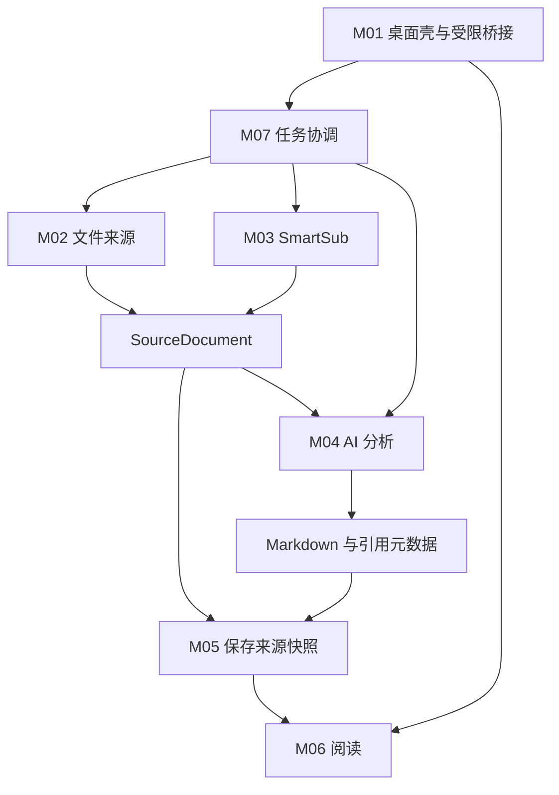

# 模块索引与接手指南

这是 ClipNote 的模块设计入口。当前已有接入探针、桌面/来源、本地版本存储与 Markdown 阅读实现，其他模块仍为设计。任务完成情况只在[任务清单](../任务清单.md)的主任务复选框维护，不能因看到设计文档就勾选实现任务。

## 1. 模块与任务对应

| 模块 | 职责 | 关联实施任务 | 计划源码位置 |
|---|---|---|---|
| [M01 桌面壳与公共契约](桌面壳与公共契约.md) | 窗口、受限 IPC、跨模块类型、凭据保护、打包入口 | T02、T03、T07、T08、T12 | `project/src/main/`、`src/preload/`、`src/contracts/` |
| [M02 文件来源](文件来源.md) | 四格式导入、原始快照、规范化片段与来源标识 | T03 | `project/src/modules/source/` |
| [M03 SmartSub 适配](SmartSub适配.md) | 安装发现、CLI、资源准备、字幕/转写任务 | T02、T10、T11 | `project/src/modules/smartsub/` |
| [M04 AI 分析](AI分析.md) | pi-ai、API/订阅、分块、结构输出、引用校验、MD 生成 | T02、T06、T07、T08、T09 | `project/src/modules/analysis/` |
| [M05 本地存储与版本](本地存储与版本.md) | 来源和笔记落盘、版本保护、保存恢复 | T04、T09、T11 | `project/src/modules/storage/` |
| [M06 Markdown 阅读](Markdown阅读.md) | 持久笔记区、Markdown/Mindmap、标题/块定位、来源回查、刷新及外部打开 | T05、T09 | `project/src/renderer/features/reader/` |
| [M07 任务协调与恢复](任务协调与恢复.md) | 阶段状态、检查点、重试、取消、服务切换和资源生命周期 | T09、T11 | `project/src/modules/jobs/` |

表中 M01/M02/M05/M06 对应目录已建立，其他源码路径仍为计划；`src/...` 相对于 `project/`。M06 的 Worker 解析位于 `src/modules/reader/`，界面位于表中 renderer 路径。T04/T05 同时扩展 M01 的存储/阅读桥接与 M02 的快照/解码接口。任务授权、负责人、实施分支、验收与实际验证见任务清单，不在模块文档复制状态。

## 2. 关系与调用方向

这是运行时调用方向，不是实现先后：M05 可先用合成 Markdown 独立验收，不依赖 AI 模块实现；M06 可打开已有 MD，不依赖一次生成任务。M02 与 M03 并列，不互相依赖。

## 3. 契约归属

- M01 维护跨进程契约文件与受限桥接；领域内容由所属模块定义，不由界面临时发明另一套结构。
- M02 定义 SourceDocument/SourceSegment 的来源语义，M03 输出同一契约；稳定来源 ID 贯穿分析、保存和阅读。
- M04 定义 ChunkPlan、NoteOutline、Profile、GenerationAttempt 的语义；API 与订阅共用分析入口但保留鉴权差异。
- M05 接收来源快照、Markdown、元数据，返回 SavedRevision；不接收或理解 AI 私有结构。
- M07 定义 Job 和阶段检查点，组合其他模块，不把具体来源网站逻辑或提示词写入任务调度。
- M06 消费磁盘文件及来源映射，不生成、重写笔记或直接调用 AI。

字段最低要求见[架构第 3 节](../架构.md#3-最小内部契约)。改变跨模块契约时，先更新受影响的模块/任务与兼容方式，再一起验证上下游。

## 4. 接手顺序

1. 读根 AGENTS、项目索引、当前交接，核对实际 Git；阅读任务清单的复选框及授权，不自行开工未授权任务。
2. 从任务清单找到当前任务及计划分支，再读对应模块与直接依赖模块；代码路径不存在时按规划识别，不假设已有实现。
3. 开工前登记实际分支、负责人和验收方式；大模块/独立子能力用独立工作分支，验证后申请合并，流程见 AGENTS。
4. 收尾更新任务清单的子项、证据与主任务勾选；模块文档只维护稳定设计，当前交接引用任务编号。

T02 是最小接入验证，不是完整 App 开发。优先验证 pi-ai 的 Electron 运行及双鉴权路径、SmartSub CLI 调用；网站适配交给 SmartSub，不要求用户先提交网站清单。

## 5. 测试入口

[测试策略](../测试策略.md)将 V01～V07 映射到 M01～M07 与实施任务，规定离线逻辑、真实接入和人工验收的边界。先读当前任务的测试要求，再按模块定位用例；测试与模块实现同步，不等最后补齐。实际运行结果与完成标记只在任务清单记录。

T02 的运行约定和 CLI 输入细节见[T02 接入契约](../T02接入契约.md)，可执行入口见[验证工具](../../project/README.md)。真实验证结果仍只在任务清单记录。
