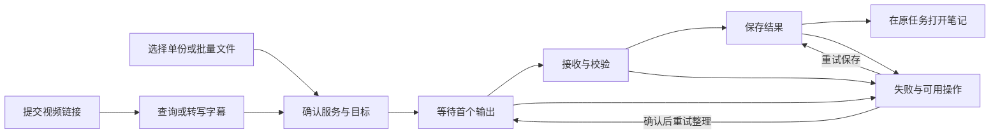

# 第二版 AI 整理交互与任务状态规格

适用 T19/T20。范围和依赖见[开发计划](第二版开发计划.md)。验收编号见[验证手册](第二版验证手册.md)。

## 页面与动作

- 资料页保留单选、多选、整理服务和目标目录。选择“AI 整理”打开统一确认区。API 支持单份/多份，订阅支持单份，多选时提示减少为一份或由用户显式改用 API。
- 视频页保留链接输入和字幕/转写选择。提交链接后建立视频任务，在应用级“任务”导航中定位该任务。转写完成后，“使用字幕”调现有导入逻辑，再在同一任务中确认模型和目标。查询需展示进行中和最近一次成功、无变化或失败。视频失败只重试适用的获取阶段。
- 统一确认区逐项展示来源与输出路径，展示接收服务和模型，订阅显示当前账户标签。检测到覆盖时增加明确确认。账户、模型、源或目标在准备后变动，旧确认失效。完成后使用已经确认的目标执行自动保存。
- 任务页左侧按创建时间倒序显示来源、服务、状态和实际耗时，右侧显示阶段、当前分块、已完成条目、失败原因和当前可用操作。从其他页面返回保留选择。批次显示逐条结果，点击单条可打开对应笔记；整体终态由条目归纳，部分失败不会掩盖成功结果。
- 用户可离开任务页继续浏览。首版设定的单活跃 AI 任务限制保留。现有操作会阻挡任务所锁定的来源和目标。只在确定分块数时显示“第 n/m 块”，计时显示已等待或处理时间。结构校验完成前不显示最终笔记。

## 共享快照

主进程分配任务 UUID，批量条目使用其既有来源 ID 加独立条目 ID。已有 SmartSub requestId、批次和订阅控制器状态由适配层关联。每条快照至少包含：

| 字段 | 约定 |
|---|---|
| taskId、itemId、kind | 各任务和条目稳定。kind 为 file / batch / video |
| attempt、revision | 重试增加 attempt，单次任务更新递增 revision。旧尝试和乱序快照丢弃 |
| service、sourceLabel、outputLabel | API 或订阅、用户可识别来源及已确认目标。只透出当前界面需要的信息 |
| state、phase、elapsedMs | 状态和阶段见下表。IPC 返回相对耗时，前端自行刷新显示 |
| chunk、counts | 已知时显示当前分块和总数，批次按条目状态统计 |
| error、actions、resultId | 受限错误类别与文案，主进程计算可用操作。只在有完整生成结果或已保存文件时附对应 ID |

## 状态与转换

| 共享状态 | 当前对象如何接入 | 转出条件与可用操作 |
|---|---|---|
| preparing / source | 资料生成输出计划，视频绑定 SmartSub 并处理 queued/running 等未完成回执 | 得到有效来源进入 ready，失败进入 failed。允许查询视频、取消任务所属操作 |
| ready / confirm | API 批次 ready、订阅 ready 或视频已导入来源 | 用户确认且计划仍匹配进入 queued 或 running。确认失效回 preparing |
| queued / waiting_turn | 批量未开始条目 | 前一条目结束后启动，取消批次移除未发请求 |
| running / waiting、receiving、validating | API 的 existing progress 与订阅文本回调进入同一状态。下一分块可以重新进入 waiting | 全部块完成并通过校验才进入 saving。失败或取消进入对应终态 |
| saving / writing | 两路复用已有工作区结果与受保护保存 | 写入并取得有效笔记引用后 succeeded。失败有完整结果时进入 save_failed |
| save_failed / writing | 存储冲突或写入失败，已有待保存结果 ID | 更换目标或重新确认覆盖后仅保存。不得再次请求模型 |
| succeeded / finished | 已保存结果，批量条目各自完成 | 打开该路径对应笔记。订阅当前 done 仅有待保存结果，接入新流程后由真实保存结果决定 succeeded |
| failed / 原阶段 | 失败保留发生阶段与类别 | 用户重试生成前验证配置、来源和目标。可复用检查点时复用 |
| cancelled / 原阶段 | 本地取消已生效，或视频接入层确认取消 | 保留已完成条目。已发出的服务请求可能已计量，文案只承诺停止本地继续处理 |

同一任务的尝试由主进程推进。取消请求发出后界面提示取消中。记录取消时的 attempt，拒绝该尝试随后到达的普通进度和成功事件。若文件已提交则显示实际已保存结果。进入写入临界区后先等待保存结果，再停止批次其余项目，避免界面显示取消但静默出现文件。阶段中止不得扩大 SmartSub 终止范围。切换条目或切页不取消任务。

## 保存和恢复

先复核用户确认的 `OutputPlan`、来源校验值和账户/模型。完全校验后暂存生成结果并尝试保存。保存服务负责写入前再次核对目标标识和版本，发生冲突时保留暂存结果。新的覆盖确认绑定当次磁盘状态。在完成后打开笔记走已有阅读动作。启动时仅从已有结果存储展示待保存项，未完成 AI 生成不自动续发。应用仍兼容第一版留下的待保存结果和旧归档。
