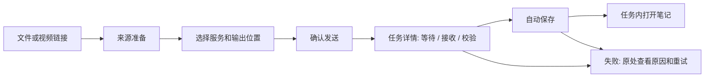

# 第二版 AI 整理流程

状态：设计提案，2026-11-17；不代表当前功能已实现。关联[开发计划](第二版开发计划.md)和[网络调研](调研/2026-11-17-AI网络链路优化.md)。

## 当前与目标

当前视频转写完成后返回资料页；API 的批量面板含阶段、耗时和保存信息，成功通常自动保存；订阅仅单份，运行时主要显示“正在整理”，完成后需到待保存区确认。两者最终都经结构与引用校验生成 Markdown。

批量任务展示总队列和逐文件详情；视频任务在同一详情中显示获取字幕或转写阶段，来源完成后进入同一整理链路。源任务已完成时重试 AI 不重新转写。

## 页面内容

任务列表显示来源名称、服务、当前阶段、已耗时、成功/失败数量和可用操作；选中后在详情显示目标位置、当前分块与请求次数、最近状态、错误说明、取消或重试，以及完成后的打开入口。后台运行时保留任务可见性；阶段和分块进度来自实际事件，不编造百分比或预计完成时间。收到未校验的流式内容只表示接收进度，不能当作最终笔记。

开始前展示接收服务、账户或模型、来源与目标；存在覆盖时单独确认，并在保存时再次检查目标是否被外部修改。API 与订阅均在确认后自动保存；成功后原任务显示结果并可直接打开。

## 场景与操作

| 场景 | 任务详情应显示 | 可执行操作 |
|---|---|---|
| 成功 | 已保存位置及完成状态 | 打开笔记 |
| 等待过久或超时 | 发生阶段、已耗时、明确错误 | 取消或手动重试 |
| 流中断 | 接收中断及已完成分块状态 | 复用有效检查点重试；不能把不完整输出标成功 |
| 取消 | 取消结果和已保留的阶段 | 重新开始或查看已完成项 |
| 保存冲突/失败 | 目标变化或失败原因，保留生成结果 | 检查目标、确认覆盖或更换位置后仅重试保存 |
| 批量部分失败 | 每项状态、结果和失败原因 | 仅重试失败项，保留成功结果 |

后续接口需提供两链路一致的任务身份、阶段事件、耗时、分块计数、错误类别和结果位置，同时保留各服务特有的鉴权信息；不得向界面传递令牌或私人正文诊断日志。订阅检查点与跨重启分析恢复目前尚未实现，需在开发时明确持久性与安全边界。
